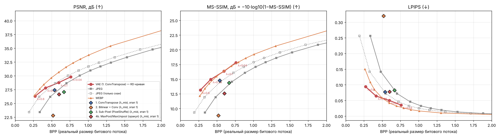

# ЛР4. Сверточный VAE для сжатия изображений CelebA 128×128

Learned-кодек изображений на основе **VAE с масштабным гиперприором** (Ballé et al., 2018; среднее и масштаб — Minnen et al., 2018).
Обучение с градиентным обрезанием, **реальное энтропийное кодирование (ANS)** латентов в битовый поток,
сравнение четырёх способов увеличения размера тензора в декодере, RD-кривые по MS-SSIM, LPIPS и PSNR в зависимости от BPP,
сравнение с JPEG и WebP.

📓 **Ноутбук с выполненными ячейками:** [`lab4_vae_celeba_compression.ipynb`](lab4_vae_celeba_compression.ipynb)  
📄 **Отчёт по лабораторной работе:** [`report_lab4.pdf`](report_lab4.pdf) — титульный лист, реферат, разделы, выводы, список источников, листинги



## Что сделано

- **Данные:** CelebA (`img_align_celeba`, PNG без потерь), центральный кроп 178×178 → **ресайз 128×128**.
  8 000 изображений официального train и 500 официального valid (другие люди). Обучение на случайных кропах 64×64
  из изображений 128×128, валидация и сжатие — на полных 128×128.
- **Модель:** g_a / g_s — 4 свёрточных блока 5×5 со страйдом 2 и GDN/IGDN, латент 8×8×128;
  гиперприор h_a / h_s → z 2×2×64. Энтропийные модели — факторизованная непараметрическая для z и условный гауссиан (μ, σ) для y.
  Обучение = минимизация взвешенного отрицательного ELBO: KL-член при равномерном апостериорном распределении равен rate в битах.
- **Функция потерь:** λ·BPP + 20·MSE + 1·(1−MS-SSIM) + 0.25·LPIPS (второй вариант из задания).
  MS-SSIM реализован вручную и сверен с `pytorch_msssim`.
- **Градиентное обрезание** по глобальной L2-норме (порог 1.0) с журналом нормы и частоты срабатывания.
- **Кодек:** квантование, **ANS** (`constriction`), реальный битовый поток и декодирование с проверкой точного совпадения символов.
  **BPP = реальный размер файла**, а не только оценка по правдоподобию. По ходу найдена и исправлена проблема
  с детерминизмом энкодера и декодера (раскладка тензора в памяти меняла μ на 10⁻⁸ и ломала ANS).
- **4 способа апсемплинга** при равном бюджете обучения. Для Max Unpooling доказана и численно проверена эквивалентность
  варианта с фиксированными индексами транспонированной свёртке. Вариант с настоящими индексами из энкодера — «оракул»,
  у которого оценена стоимость передачи индексов.
- **RD-кривые** для 4 значений λ, сравнение с JPEG (полный файл и только данные скана) и WebP на тех же 500 изображениях,
  **BD-rate**, визуальные сравнения при близком битрейте, карта распределения бит по изображению.

## Результаты

### Способы увеличения размера тензора (λ = 0.1, 3 000 шагов, валидация 500 × 128×128)

| Вариант | Параметры, M | GMAC декодера | BPP (реальный) | PSNR, дБ | MS-SSIM | LPIPS ↓ |
|---|---|---|---|---|---|---|
| 1. ConvTranspose | 1.74 | 0.16 | 0.538 | 27.40 | 0.9667 | 0.0772 |
| 2. Bilinear + Conv | 1.74 | 0.66 | 0.519 | 22.81 | 0.8692 | 0.3203 |
| 3. Sub-Pixel (PixelShuffle) | 1.92 | 0.24 | 0.666 | 27.07 | 0.9635 | 0.0828 |
| 4b. MaxPool/MaxUnpool (оракул) | 1.74 | 0.66 | 0.601 (+≈43 bpp за индексы) | 26.63 | 0.9447 | 0.0777 |

### RD-кривая лучшего варианта и классические кодеки

| Кодек | Параметр | BPP | PSNR, дБ | MS-SSIM | LPIPS ↓ |
|---|---|---|---|---|---|
| **VAE** | λ=0.04 | 0.760 | 29.80 | 0.9835 | 0.0353 |
| **VAE** | λ=0.1 | 0.597 | 28.76 | 0.9768 | 0.0499 |
| **VAE** | λ=0.25 | 0.416 | 27.80 | 0.9681 | 0.0641 |
| **VAE** | λ=0.6 | 0.273 | 26.30 | 0.9515 | 0.0939 |
| JPEG | q=5 | 0.336 | 23.40 | 0.8829 | 0.2561 |
| JPEG | q=10 | 0.481 | 26.20 | 0.9360 | 0.1420 |
| JPEG | q=20 | 0.704 | 28.66 | 0.9649 | 0.0720 |
| JPEG | q=30 | 0.884 | 30.03 | 0.9753 | 0.0456 |
| WebP | q=1 | 0.266 | 26.45 | 0.9386 | 0.1499 |
| WebP | q=10 | 0.394 | 28.42 | 0.9625 | 0.0849 |
| WebP | q=30 | 0.597 | 30.65 | 0.9771 | 0.0422 |
| WebP | q=40 | 0.698 | 31.57 | 0.9811 | 0.0321 |

**BD-rate VAE** (средняя разница битрейта при равном качестве, отрицательное значение — экономия):

| Эталон | PSNR | MS-SSIM (дБ) | LPIPS |
|---|---|---|---|
| JPEG | **−28.0%** | **−41.8%** | **−42.5%** |
| JPEG (только данные скана, без заголовков) | −4.5% | −27.2% | −27.2% |
| WebP | +27.1% | **−5.4%** | **−8.5%** |

## Выводы

- Кодек полностью рабочий: битовый поток декодируется без ошибок, реальный BPP совпадает с оценкой по правдоподобию
  с точностью **0.001 bpp**.
- VAE **обгоняет JPEG по всем трём метрикам** и **WebP по перцептивным метрикам** (MS-SSIM, LPIPS), но уступает WebP по PSNR.
  Модель оптимизирует перцептивную смесь потерь и обучалась всего ~6 тыс. шагов на CPU.
- Лучший способ апсемплинга при равном бюджете — **транспонированная свёртка**: лучший RD-компромисс и самый дешёвый декодер.
  Sub-Pixel почти не уступает. Билинейная интерполяция + свёртка обучается нестабильно и медленно.
  Max Unpooling с фиксированными индексами ≡ транспонированная свёртка (проверено численно), а с индексами энкодера
  требует ≈ 43 bpp на их передачу, что больше несжатого изображения.
- Градиентное обрезание обязательно: без него при lr = 10⁻³ обучение расходилось (NaN / взрыв градиентов).

## Запуск

```bash
pip install -r requirements.txt
jupyter nbconvert --to notebook --execute lab4_vae_celeba_compression.ipynb
```

Ноутбук сам скачает два Parquet-шарда CelebA с Hugging Face (`flwrlabs/celeba`, ~0.9 ГБ) в `data/`.
`LAB4_QUICK=1` — быстрая проверка пайплайна на крошечных настройках. Обученные веса для всех значений λ лежат в `checkpoints/`.
Полный прогон на 2 ядрах CPU занимает ~1.5–2 часа. На GPU можно и нужно увеличить число шагов в `CFG`:
статьи используют сотни тысяч шагов, здесь — 1.5–6 тысяч.

## Источники

- J. Ballé, V. Laparra, E. Simoncelli. *End-to-end Optimized Image Compression*, ICLR 2017.
- J. Ballé et al. *Variational Image Compression with a Scale Hyperprior*, ICLR 2018.
- D. Minnen, J. Ballé, G. Toderici. *Joint Autoregressive and Hierarchical Priors for Learned Image Compression*, NeurIPS 2018.
- D. Minnen, S. Singh. *Channel-wise Autoregressive Entropy Models for Learned Image Compression*, ICIP 2020.
- Z. Wang, E. Simoncelli, A. Bovik. *Multi-scale Structural Similarity for Image Quality Assessment*, 2003.
- R. Zhang et al. *The Unreasonable Effectiveness of Deep Features as a Perceptual Metric* (LPIPS), CVPR 2018.
- W. Shi et al. *Real-Time Single Image and Video Super-Resolution Using an Efficient Sub-Pixel CNN*, CVPR 2016.
- G. Bjøntegaard. *Calculation of average PSNR differences between RD-curves*, VCEG-M33, 2001.
- Z. Liu et al. *Deep Learning Face Attributes in the Wild* (CelebA), ICCV 2015.
